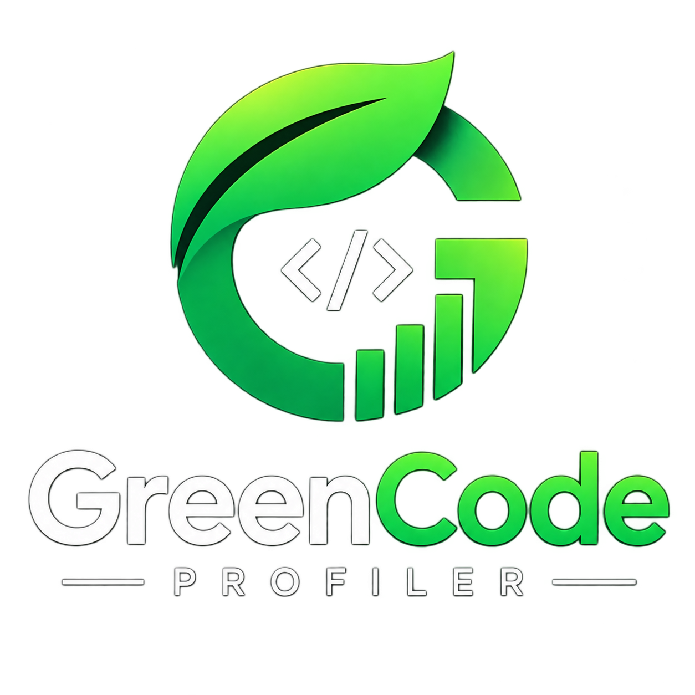

<p align="center">
  
</p>

# Green Profiler

**Universal Process-Level Energy & Code Quality Profiler for Modern Web Applications**

[](LICENSE)
[](https://www.rust-lang.org)
[]()
[](https://greenprofiler.github.io)
[](https://github.com/greenprofiler/greenprofiler/releases)

Green Profiler v1.9.0 is an advanced, high-performance auditing framework for software energy efficiency (*Green Software Engineering*), static architectural quality analysis, and runtime environment efficiency. Built in **Pure Native Rust**, it isolates CPU kernel execution time from I/O and network wait bias, delivering deterministic computational metrics without requiring any external interpreter or runtime dependency.

🌐 **Official Website & Installation Guide**: [https://greenprofiler.github.io](https://greenprofiler.github.io)

---

## Overview

Green Profiler is engineered with a strict **Zero-Dependency Runtime** philosophy. End users, security auditors, and software engineers **do not need** to install a Rust toolchain, Python runtime, Node.js, or PHP on their host machines to profile their systems. The profiler is shipped as a single, lightweight standalone binary.

### Key Features

1. **Rust Native Engine:** Ultra-low CPU and memory overhead with zero-cost abstractions and sub-millisecond dispatching.
2. **I/O Wait Isolation:** Measures energy strictly from active CPU kernel time ($t_{\text{user}} + t_{\text{system}}$) via Windows NT Kernel APIs (`GetProcessTimes`) and Linux `/proc/[PID]/stat`, completely eliminating distortions caused by network latency or database query queues.
3. **Static Code Quality Inspection:** Evaluates Cyclomatic Complexity (CCN), Maintainability Index (MI), Non-Comment Lines of Code (NCLOC), and flags architectural code smells (*God Class*, *Fat Controller*, *Deep Nesting*).
4. **PHP Runtime & Green Extension Auditing:** Audits availability of critical PHP extensions (MySQL, OpenSSL, cURL), energy-saving CPU cycle accelerators (*Zend OPcache*, *JIT Compiler*), and alerts against energy-expensive profilers (*Xdebug*).
5. **Monorepo & Multi-Service Support:** Discovers and benchmarks complex fullstack monorepos (e.g., Next.js frontend + Laravel backend) simultaneously.
6. **Language-Agnostic External Profiling:** Runs outside the target application process. Natively benchmarks **Node.js** (Next.js, Express, NestJS), **PHP** (Laravel, Lumen), **Python** (FastAPI, Flask, Django), **Go** (Gin, Chi, net/http), and **Rust** (Actix, Axum).
7. **Comprehensive HTML Reports:** Generates polished, responsive dashboard reports with embedded offline assets, dynamic threshold badges, runtime recommendations, and technical parameters.
8. **Automated Cross-Language Route Discovery:** Scans source code routes automatically across route groups, nested handlers, and file-based routers. Parameterized routes are gracefully skipped during initial benchmark suites to prevent HTTP 404 false positives.
9. **Endpoint-Aggregated Metrics:** Consolidates multiple benchmark iterations into single-row averages per endpoint, preventing repetitive, bloated reports.
10. **Dual CLI Commands:** Supports both canonical `greenprofiler` and ergonomic short alias `gp`.
11. **Filtering & Custom Outputs:** Supports `--filter` and `--exclude` flags for targeted endpoint and file analysis, along with `--output` for side-by-side comparative benchmarking.

---

## Quick Installation (One-Line Script)

Choose your operating system:

### 1. Windows (PowerShell)
Run in PowerShell to automatically download, extract, and register the binary to your user `PATH`:
```powershell
irm https://greenprofiler.github.io/install/install.ps1 | iex
```

### 2. Windows (Command Prompt / CMD)
Run in Command Prompt:
```cmd
curl -fsSL https://greenprofiler.github.io/install/install.cmd -o install.cmd && install.cmd && del install.cmd
```

### 3. macOS & Linux (Terminal)
Run in Terminal (supports Linux x64, macOS Apple Silicon M1/M2/M3/M4, and macOS Intel):
```bash
curl -fsSL https://greenprofiler.github.io/install/install.sh | bash
```

Once installed, open a new terminal window. You can immediately invoke either `greenprofiler` or `gp`:
```bash
# 1. Initialize routes and configuration automatically
greenprofiler init

# 2. Run energy & code quality profiling
greenprofiler run
```

---

## CLI Command Reference

Both `greenprofiler` and `gp` accept identical flags and subcommands:

| Command | Alias | Arguments & Flags | Description |
| :--- | :--- | :--- | :--- |
| `greenprofiler init` | `gp init` | `[--force] [--filter K] [--exclude K]` | Generate `greenprofiler.json` configuration with automatic route discovery |
| `greenprofiler run` | `gp run` | `[config.json] [--strict] [--users N] [--no-open] [--filter K] [--output file]` | Run energy profiling, code architecture benchmarks & multi-user simulation |
| `greenprofiler analyze` | `gp analyze` | `[config.json] [--strict] [--no-open] [--filter K] [--exclude K] [--output file]` | Run calibrated static code quality analysis, PHP Extension candidate detection & scale projection |
| `greenprofiler simulate` | `gp simulate` | `[report.json] [--users N] [--rpu N] [--cores C] [--window S] [--no-open]` | Simulate multi-user concurrency load, CPU saturation, P95 latency, monthly kWh & CO2e from audit results |
| `greenprofiler routes` | `gp routes` | `[dir] [--limit N] [--filter K] [--exclude K]` | Discover and list all valid application routes from source code |
| `greenprofiler detect` | `gp detect` | `[language]` | Detect active application server processes, PIDs, and bound ports |
| `greenprofiler ui` | `gp ui` | - | Open the latest HTML report in your default web browser |
| `greenprofiler version`| `gp version`| - | Display version and engine architecture information |
| `greenprofiler help` | `gp help` | `[command]` | Show interactive command help and parameter details |

---

## Configuration Schema (`greenprofiler.json`)

Example configuration for a fullstack monorepo application:

```json
{
  "project_name": "Fullstack Platform",
  "runtime": "fullstack",
  "base_url": "http://127.0.0.1:8000",
  "services": {
    "frontend": "http://127.0.0.1:3000",
    "backend": "http://127.0.0.1:8000"
  },
  "source_dirs": ["backend/app", "frontend/src"],
  "repeats": 5,
  "cpu_tdp_watts": 15.0,
  "endpoints": [
    {
      "name": "[FE] Dashboard Overview",
      "method": "GET",
      "path": "/admin/dashboard",
      "service": "frontend",
      "url": "http://127.0.0.1:3000/admin/dashboard"
    },
    {
      "name": "[BE] User Data API",
      "method": "GET",
      "path": "/api/users",
      "service": "backend",
      "url": "http://127.0.0.1:8000/api/users"
    }
  ]
}
```

---

## Audit Evaluation Metrics & Thresholds

Generated HTML reports (`reports/greenprofiler_report.html`) classify metrics against objective engineering standards:

| Metric | Unit / Scale | Target Threshold | Technical Meaning |
| :--- | :--- | :--- | :--- |
| **Total Energy** | Joules (J) / kWh | < 2.0 J per request | Net active electrical energy drawn by the server CPU ($E = P_{\text{avg}} \times t_{\text{active}}$) |
| **Active CPU Time** | Seconds (s) | Workload-dependent | Real execution time on CPU cores, fully isolated from I/O wait times |
| **Green Score** | 0 – 100 | $\ge$ 85 (Optimal) | Algorithmic ratio score of computational energy efficiency vs throughput & latency |
| **CCN** | Integer | 1 – 10 (Low / Healthy) | Cyclomatic Complexity Number measuring independent code paths |
| **Maintainability Index** | 0 – 100 | $\ge$ 85 (Grade A) | Composite maintainability metric based on Halstead volume, CCN, and NCLOC |
| **Code Smells** | Count | 0 findings | Architectural smell violations (*God Class*, *Fat Controller*, *Deep Nesting*) |

---

## Building from Source

To compile the binaries directly from source:

```bash
git clone https://github.com/greenprofiler/greenprofiler.git
cd greenprofiler
cargo build --release
```

The compiled release binary will be available at:
* Windows: `target/release/greenprofiler.exe`
* Linux / macOS: `target/release/greenprofiler`

---

## Repository Structure

```
greenprofiler/
├── .github/
│   └── workflows/
│       └── release.yml     - Automated cross-platform release builder
├── assets/
│   └── logo.png            - Official Green Profiler branding logo
├── bin/
│   └── greenprofiler.exe   - Native release binary
├── install/
│   ├── install.ps1         - PowerShell installer for Windows
│   ├── install.cmd         - Command Prompt installer for Windows
│   └── install.sh          - Shell installer for macOS & Linux
├── src/
│   ├── main.rs             - Entry point & CLI dispatcher
│   ├── engine.rs           - ProcessEnergyEngine (Windows FFI / Linux procfs)
│   ├── attributor.rs       - ModuleAttributor & native TcpStream tracer
│   ├── correlator.rs       - Energy & code quality correlation engine
│   ├── analyzer/           - Static code quality analyzer (NCLOC, CCN, MI, Smells)
│   ├── cli/                - Flag parser, filter logic, and interactive help
│   ├── commands/           - Subcommand implementations (init, run, analyze, routes, detect, ui)
│   ├── detector/           - Runtime detector & multi-language route discovery
│   ├── php_auditor/        - PHP runtime & Green Extension audit module
│   ├── reporter/           - Structured HTML & JSON report generator
│   └── logo_base64.txt     - Embedded Base64 logo for offline reports
├── examples/               - Sample configuration files for Next.js, Laravel, FastAPI, etc.
├── Cargo.toml              - Rust manifest & build targets (greenprofiler, gp)
├── LICENSE                 - MIT License
└── README.md               - Project documentation
```

---

## License

This project is licensed under the terms of the [MIT License](LICENSE).
